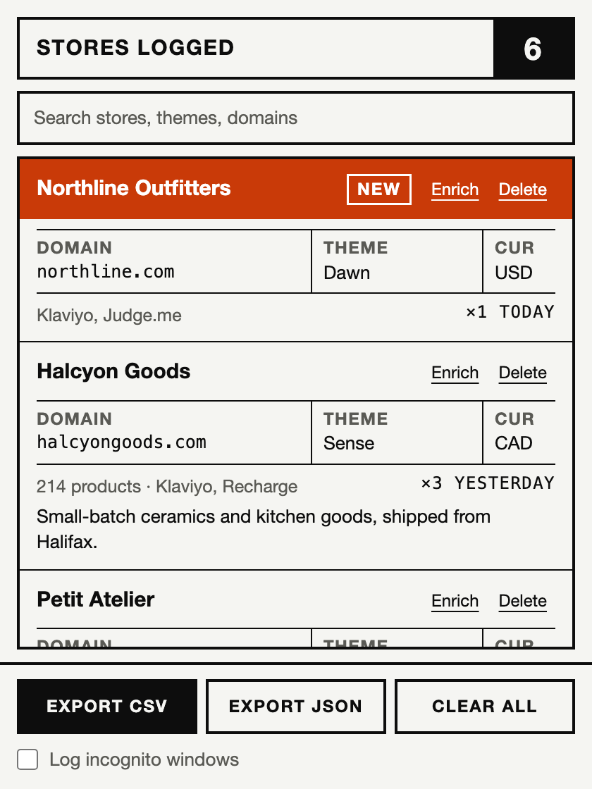
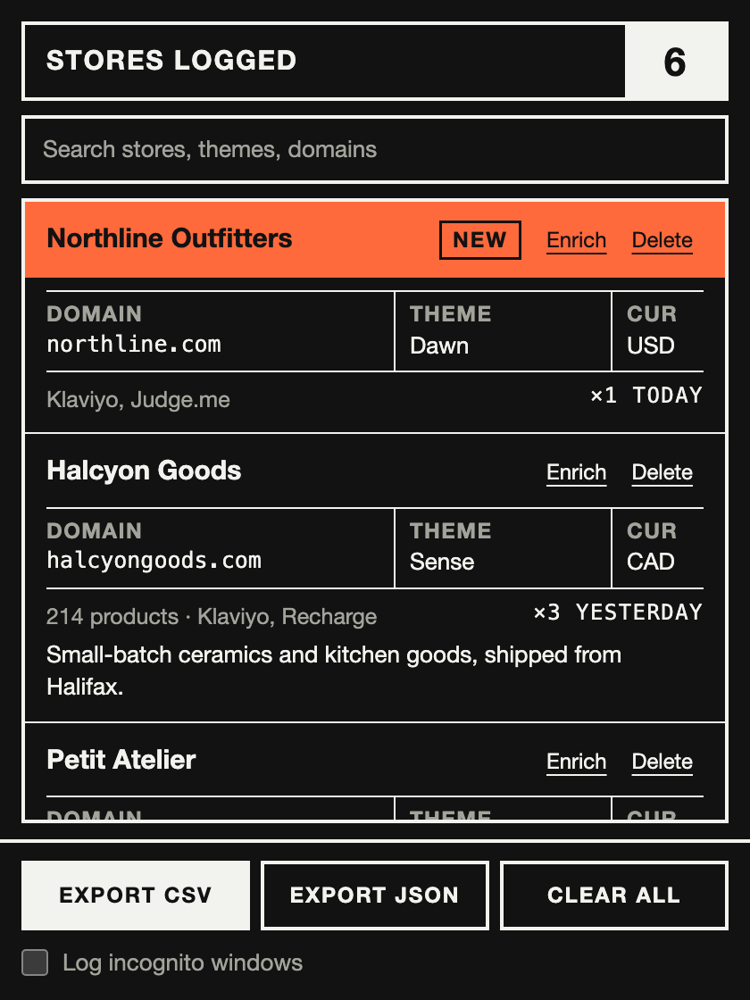

# Shopify Store Detector

A small Chrome extension that notices when the site you're on is a Shopify store and adds it to a list. I made it to keep track of Shopify stores for a personal project I'm building.

<p>
  
  
</p>

(The stores in the screenshots are made up.)

## What it does

Just browse like normal. When a page turns out to be a Shopify store, it gets saved with its name, domain, theme, currency, and any popular apps it's running (Klaviyo, Judge.me, Recharge and a few others). The toolbar icon gets an S badge on that tab so you know it caught one.

Open the popup to see everything you've collected, most recent first. Anything you haven't seen since the last time you opened it gets a bright orange header so new stuff stands out.

From the popup you can:

- search by name, domain or theme
- delete a store
- hit **Enrich** to pull in the product count and description
- export the whole list as CSV or JSON

## Install

It's not on the Chrome Web Store, so you load it yourself. It only takes a minute.

1. Download or clone this repo.
2. Go to `chrome://extensions` and switch on **Developer mode**.
3. Click **Load unpacked** and pick the folder.

If you want it to log incognito windows too, tick the box at the bottom of the popup and allow the extension in incognito from `chrome://extensions`.

## Privacy

Everything stays in your browser. There's no server, no account and no analytics. The only time the extension makes its own network request is when you click Enrich, and Chrome asks for your permission for that specific site first. Incognito windows are ignored unless you turn them on.

## How it spots a store

It looks for the `Shopify` object that stores put on the page and for Shopify's meta tags. Loading a file from `cdn.shopify.com` isn't enough on its own, so a blog post about Shopify won't get added.

## Things to know

- The app list is short and lives in `src/apps.js`. Add your own if something's missing.
- Enrich reads the store's `/meta.json`. Not every store has it turned on, so sometimes you'll get an error.
- Headless setups (like Hydrogen) can look different from a normal Shopify theme, so they may get missed.

## Development

There's no build step. The code is plain JavaScript, and the detection logic, list handling and CSV export have tests. You need Node 20 or newer.

```
npm test
```

Where things live:

- `src/detect.js` decides whether a page is a Shopify store
- `src/store.js` handles the saved list
- `src/csv.js` builds the export
- `src/background.js` is the service worker that saves everything
- `popup/` is the popup UI

## License

MIT. Do whatever you want with it. See [LICENSE](LICENSE).
